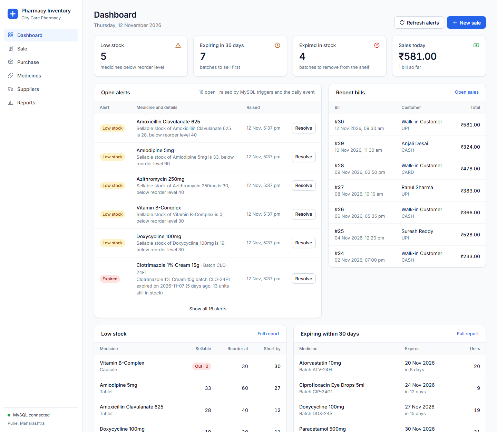
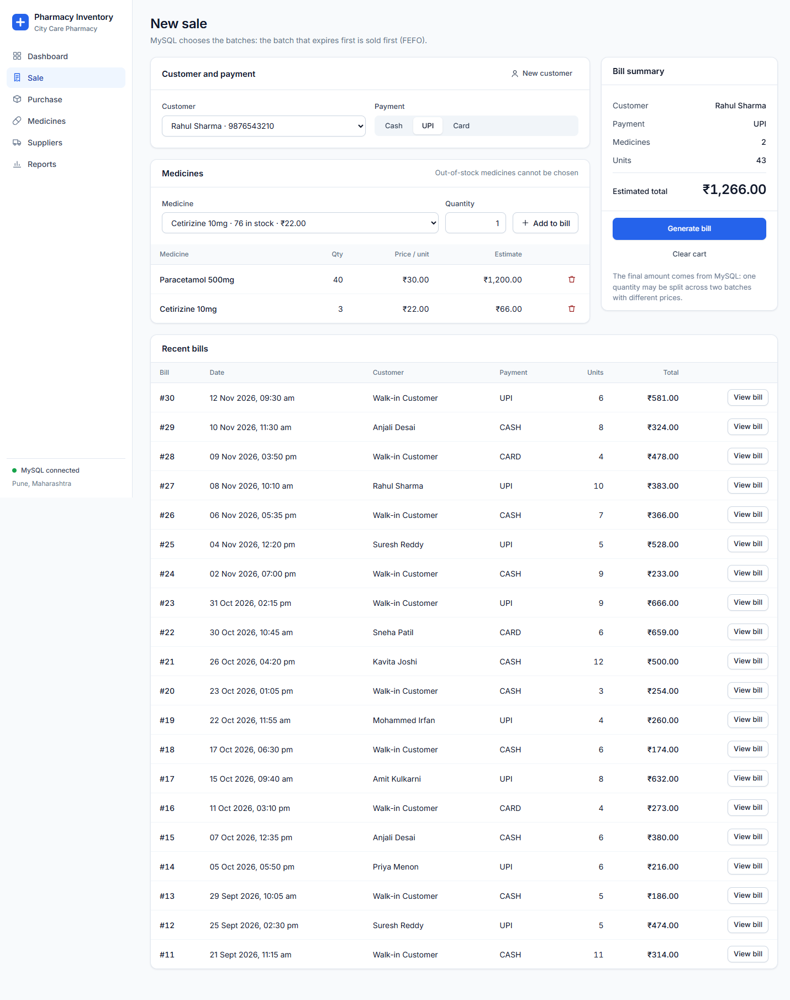
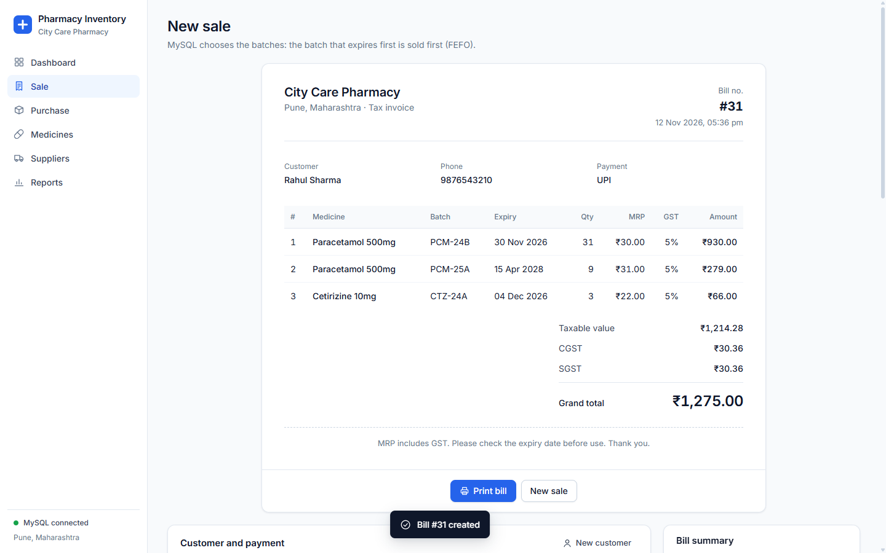
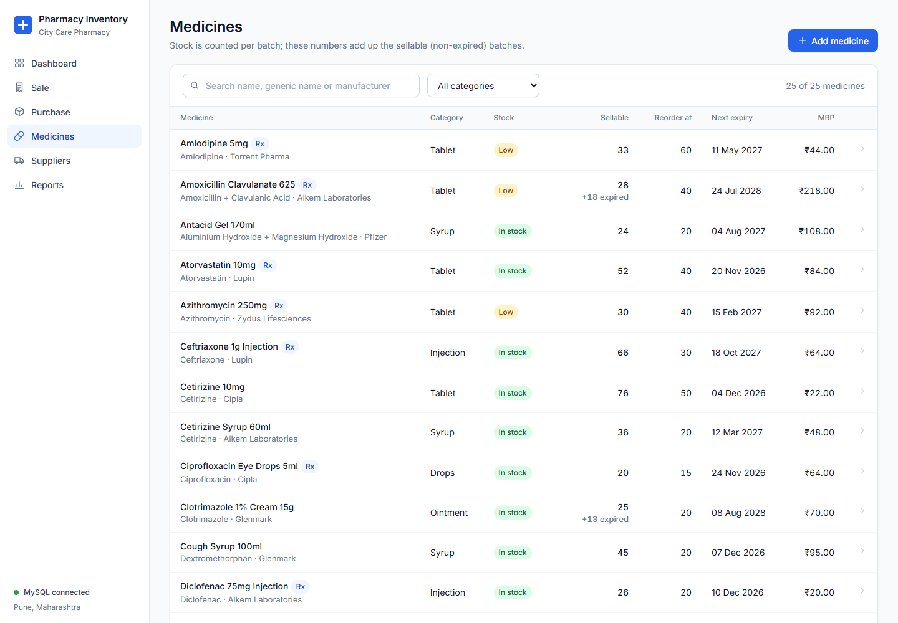
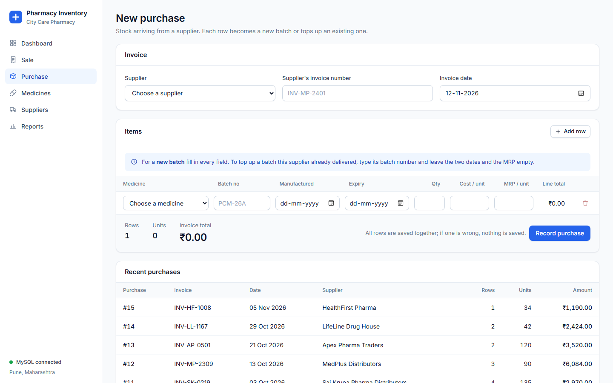
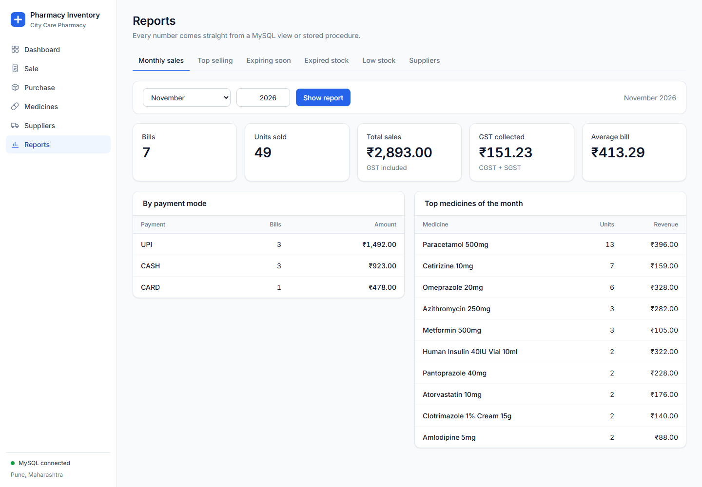

<!--
=====================================================================
FILE        : README.md
WHAT IT DOES: The front page of the project: what the system does, the technology, the folder
              structure, how to install and run everything, how to test it, and where to find
              the documentation.
DEPENDS ON  : nothing (it describes the other files).
USED BY     : everybody - read it FIRST (docs/reading_order.md step 1).
READ ORDER  : 1st
=====================================================================
-->

# Pharmacy Inventory & Expiry Management System

A DBMS course project: a pharmacy keeps track of **medicines, suppliers, batches, stock, purchases, sales,
expiry dates and low-stock alerts**.
**All the data and all the business rules live in MySQL 8** (tables, constraints, views, triggers, stored
procedures and a scheduled event). The Python backend and the web pages only *call* the database.

> Tested on **MySQL 8.0.46** and **8.4.9**, **Python 3.12**, Windows 11. The sample data is built relative to
> today's date, so the demo is correct on any day.

---

## 1. What it can do

| Area | Features |
|------|----------|
| **Stock per batch** | Every batch has its own expiry date, price and quantity. |
| **Safe selling** | A trigger refuses to sell an **expired** batch or **more than is in stock**. |
| **FEFO** | *First Expired, First Out*: a sale automatically takes units from the batch that expires first, and is split across batches when needed. |
| **Billing** | Several medicines on one bill; printable bill with GST (CGST + SGST) calculated by MySQL. |
| **Purchasing** | A purchase creates a new batch or tops up an existing one; the stock rises automatically. |
| **Alerts** | LOW_STOCK (after a sale), NEAR_EXPIRY (30 days) and EXPIRED alerts - created by triggers and a **daily event**, never duplicated. |
| **All-or-nothing** | Procedures use transactions: if anything fails, nothing is saved. |
| **Reports** | Monthly sales, top-selling medicines, expiring soon, expired stock, low stock, supplier summary. |

## 2. Screenshots

| Dashboard | Sale page |
|:---:|:---:|
|  |  |
| **Printable bill** (FEFO split: Paracetamol taken from two batches) | **Medicines** |
|  |  |
| **Purchase** | **Reports** |
|  |  |

*(Also in `docs/screenshots/`: `suppliers.png`.)* Replace these pictures with screenshots of your own running copy before the submission.

## 3. Tech stack

| Layer | Technology | Why |
|-------|-----------|-----|
| Database | **MySQL 8** (InnoDB) | Tables, `CHECK`, foreign keys, views, triggers, procedures, events, window functions, JSON |
| Backend | **Python 3 + FastAPI** + `mysql-connector-python` | Tiny layer that calls procedures and views with parameterized queries (no ORM) |
| Frontend | **React (JSX) + Vite**, react-router, plain CSS | Component-based pages; no UI library, so every line can be explained |
| Docs | Markdown + Mermaid | ER diagram and flowcharts that render on GitHub / VS Code |

## 4. How a click reaches the database

```
button click -> React page (Sale.jsx) -> api.js (fetch) -> FastAPI route (routes/sales.py)
             -> db.py (connection) -> MySQL procedure sp_make_bill -> triggers
             -> answer travels back the same way -> React stores it in state and draws the bill
```

Details and the full map: [`docs/file_connections.md`](docs/file_connections.md).

## 5. Folder structure

```
pharmacy-inventory-system/
├── README.md                    <- you are here
├── database/                    ALL MySQL code, numbered in the order to run
│   ├── 01_create_database.sql      creates the database
│   ├── 02_tables.sql               10 tables with keys, CHECKs and indexes
│   ├── 03_sample_data.sql          suppliers, medicines, batches, purchases, sales
│   ├── 04_views.sql                13 views
│   ├── 05_triggers.sql             5 triggers (stock + alerts, automatic)
│   ├── 06_procedures.sql           9 stored procedures (the business logic)
│   ├── 07_events.sql               daily alert event
│   ├── 08_demo_queries.sql         20 practice queries (SELECT ... window functions)
│   ├── 09_test_cases.sql           45 automatic PASS/FAIL checks
│   └── run_all.sql                 builds everything: runs 01 to 07
├── backend/                     Python FastAPI app (no business logic, only calls MySQL)
│   ├── requirements.txt
│   ├── .env.example                template for the database login (copy to .env)
│   ├── main.py                     starts the app, CORS, error handler
│   ├── db.py                       one function: get_connection()
│   └── routes/                     medicines, suppliers, purchases, sales, alerts, reports
├── frontend/                    React (JSX) app built with Vite
│   ├── package.json                dependencies and npm scripts (npm run dev)
│   ├── index.html                  the one html page; React draws into <div id="root">
│   └── src/
│       ├── main.jsx  App.jsx       entry point and the list of pages (routes)
│       ├── api.js                  every fetch() call to the backend
│       ├── useLoad.js  utils.js    data-loading hook, money/date formatting
│       ├── styles.css              the whole look (tokens, sidebar, tables, bill, print)
│       ├── components/             Layout (sidebar), Toast, Badge, Icon, PageHeader, StatCard, BillView, MedicineForm
│       └── pages/                  Dashboard, Medicines, MedicineDetail, MedicineNew, Suppliers, Purchase, Sale, Reports
└── docs/                        design and viva material
    ├── er_diagram.md               ER diagram (Mermaid) + explanation
    ├── normalization.md            UNF -> 1NF -> 2NF -> 3NF and the 3NF proof
    ├── file_connections.md         flowchart 1: how the files connect
    ├── reading_order.md            flowchart 2: the order to read the code
    ├── work_split.md               who explains what (4 members)
    ├── viva_questions.md           15 likely questions with answers
    └── screenshots/                pictures used in this README
```

## 6. Setup - step by step

### Step 1 - Install the tools (once)
* **MySQL Server 8** (8.0 or 8.4) and optionally MySQL Workbench - <https://dev.mysql.com/downloads/>. Remember the password you set for `root`.
* **Python 3.10 or newer** - <https://www.python.org/downloads/> (tick "Add Python to PATH" on Windows).
* **Node.js 20 or newer** - <https://nodejs.org/> (for the React frontend).

### Step 2 - Build the database
Open a terminal **inside the `database` folder** and run:

```bash
cd pharmacy-inventory-system/database
mysql -u root -p < run_all.sql
```

It asks for your MySQL password, then creates `pharmacy_db`, the tables, the sample data, views, triggers,
procedures and the daily event, and fills the first alerts. `run_all.sql` runs `01` to `07` in order.
Run it again at any time to **reset** the database to the original sample data.

> **MySQL Workbench instead?** Workbench does not understand `SOURCE`. Open `01_create_database.sql`, run it
> (lightning bolt), then do the same for `02`, `03`, `04`, `05`, `06`, `07` **in this order**.
> `07_events.sql` needs the `root` account (it runs `SET GLOBAL event_scheduler = ON;`).

Check it worked:

```sql
USE pharmacy_db;
SELECT * FROM v_low_stock;            -- 5 medicines
SELECT * FROM v_expiring_soon;        -- 7 batches
SELECT COUNT(*) FROM stock_alert;     -- 16 alerts
```

### Step 3 - Start the backend
```bash
cd pharmacy-inventory-system/backend

python -m venv venv                  # create a private Python environment (once)
venv\Scripts\activate                # Windows   (Mac/Linux: source venv/bin/activate)
pip install -r requirements.txt      # install FastAPI, uvicorn, the MySQL driver

copy .env.example .env               # Windows   (Mac/Linux: cp .env.example .env)
#  -> open the new file ".env" and write YOUR MySQL password after DB_PASSWORD=

uvicorn main:app --reload            # start the server on http://127.0.0.1:8000
```

Open <http://127.0.0.1:8000/health> - you should see `{"status":"ok","database":"connected"}`.
Open <http://127.0.0.1:8000/docs> to try every endpoint in the browser (automatic API documentation).

### Step 4 - Start the website (React)
Open a **second** terminal (leave the backend running) and run:

```bash
cd pharmacy-inventory-system/frontend
npm install          # once: downloads React, react-router and Vite (needs Node.js 20 or newer)
npm run dev          # starts the website on http://127.0.0.1:5173
```

Open <http://127.0.0.1:5173> in your browser. It shows the dashboard.
(If the backend is not at `http://127.0.0.1:8000`, copy `frontend/.env.example` to `frontend/.env` and change `VITE_API_URL`.)

Things to try:
1. **Sale** page: add *Paracetamol 500mg x 40* -> Generate bill. Look at the batches: the bill takes 31 units from the batch that expires first and 9 from the next one (FEFO).
2. **Sale** page: try *Azithromycin x 31* (only 30 can be sold) - MySQL refuses, nothing is saved.
3. **Purchase** page: buy stock; the quantity rises by itself (trigger).
4. **Dashboard**: the alerts appear; press *Resolve*.

### Step 5 - Run the tests (optional but impressive)
```bash
cd pharmacy-inventory-system/database
mysql -u root -p < run_all.sql                 # clean start
mysql -u root -p --force < 09_test_cases.sql   # --force: continue after the expected errors
```
The last lines show the score: **45 PASS, 0 FAIL**. The lines starting with `ERROR 1644` are the *expected*
failure cases (selling expired stock and so on). Run `run_all.sql` again afterwards to get a clean database.

## 7. The important design decisions (short)

* **Stock lives per batch** (`batch.quantity_in_stock`); the medicine's stock is the sum of its non-expired batches.
* **Sellable stock** = batches with `expiry_date >= today`. Expired units never count for sales or for the low-stock rule.
* **Prices are MRP, GST included** (as in India); the GST amount on the bill is extracted: `line_total x gst% / (100 + gst%)`.
* **Price snapshots**: `sale_item` stores the price and GST rate used on that bill, so old bills never change.
* **No stored totals**: totals are calculated by views/procedures, so they cannot disagree with the items.
* **Triggers keep stock correct** (the only place where stock changes), **procedures make multi-table work all-or-nothing**, **an event raises the time-based alerts**.
* The whole design and its 3NF proof: [`docs/er_diagram.md`](docs/er_diagram.md), [`docs/normalization.md`](docs/normalization.md).

## 8. Documentation index

| File | What it is |
|------|-----------|
| [`docs/er_diagram.md`](docs/er_diagram.md) | Entities, keys, relationships, ER diagram |
| [`docs/normalization.md`](docs/normalization.md) | UNF -> 3NF step by step, 3NF proof, honest footnotes |
| [`docs/file_connections.md`](docs/file_connections.md) | **Flowchart 1** - how all files connect |
| [`docs/reading_order.md`](docs/reading_order.md) | **Flowchart 2** - the order to read the code |
| [`docs/work_split.md`](docs/work_split.md) | Division of work and viva roles |
| [`docs/viva_questions.md`](docs/viva_questions.md) | 15 viva questions with answers |

## 9. Troubleshooting

| Problem | Cause and fix |
|---------|---------------|
| Web page says **"Cannot reach the server"** | The backend is not running. Start it: `uvicorn main:app --reload` inside `backend/`. |
| `/health` answers **503 Cannot reach the MySQL database** | MySQL is stopped, or `backend/.env` has the wrong password/port. Fix `.env`, restart uvicorn. |
| `ERROR 1045 Access denied for user 'root'` | Wrong MySQL password (in the terminal or in `.env`). |
| `Unknown database 'pharmacy_db'` | `run_all.sql` was not run yet (Step 2). |
| `SOURCE` does nothing / error in Workbench | `SOURCE` works only in the `mysql` command-line client, started from the `database` folder. In Workbench run the files one by one. |
| `SET GLOBAL event_scheduler` fails | Use the `root` account, or ask your admin; or press **Refresh alerts** on the dashboard instead. |
| Alerts are not created every day | The scheduler is OFF after a server restart. `SET GLOBAL event_scheduler = ON;` (or `SET PERSIST ...`). Check: `SHOW VARIABLES LIKE 'event_scheduler';` |
| Port 8000 already in use | `uvicorn main:app --reload --port 8001` and set `VITE_API_URL=http://127.0.0.1:8001` in `frontend/.env` and restart `npm run dev`. |
| `venv\Scripts\activate` is blocked in PowerShell | Run `Set-ExecutionPolicy -Scope Process Bypass` first, or use Command Prompt (`cmd`). |
| Numbers on the dashboard differ from the README | The sample data uses today's date; counts stay the same, the dates move. After testing, run `run_all.sql` to reset. |

## 10. Team

| Member | Part |
|--------|------|
| Member 1 | ER design, normalization, tables |
| Member 2 | Sample data, views, demo queries |
| Member 3 | Triggers, procedures, events, tests |
| Member 4 | Backend, frontend, README |

*(Write your real names here - see [`docs/work_split.md`](docs/work_split.md).)*
