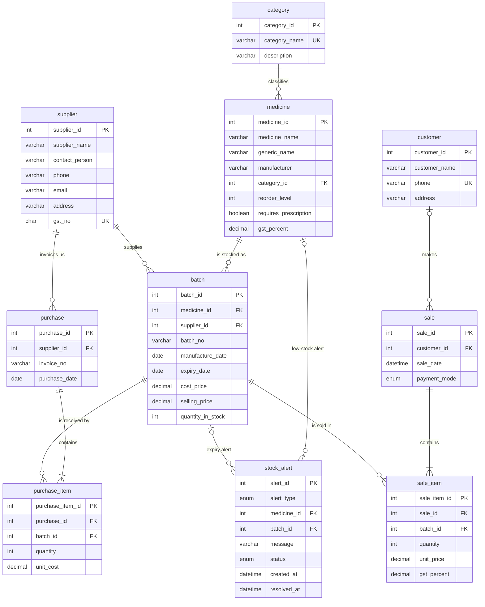

<!--
=====================================================================
FILE        : docs/er_diagram.md
WHAT IT DOES: Describes the DESIGN of the database before any SQL is written:
              the entities (tables), their attributes, primary keys, foreign
              keys, relationships with cardinality, and an ER diagram.
DEPENDS ON  : Nothing. This is the first design document.
USED BY     : database/02_tables.sql (every table there is built from this
              file), docs/normalization.md (proves this design is in 3NF),
              all other SQL files (they use the table and column names below).
READ ORDER  : 2nd, right after README.md.
=====================================================================
-->

# Entity-Relationship (ER) Design — Pharmacy Inventory & Expiry Management

## 1. What this system stores (in one paragraph)

A pharmacy buys medicines from **suppliers** in **purchases**. Every purchase line
arrives as a **batch** (a manufacturing lot with its own batch number and **expiry date**).
Stock is therefore counted **per batch**, not per medicine. Customers buy medicines
in **sales**; every sale line is taken from one specific batch. When stock is low or
a batch is about to expire (or has expired), the system raises a **stock alert**.

> **Unit of quantity:** one *sellable unit* — one strip, one bottle, one vial, one tube.
> `quantity_in_stock = 40` means 40 strips (or bottles ...) are on the shelf.
> `selling_price` is the price of ONE unit and is the **MRP, GST included**
> (this is how medicines are sold in India; the GST part is extracted on the bill).

---

## 2. Design decisions — where I changed or added to your brief

You said "adjust if you see a better design, but explain why". These are all the changes.

| # | Decision | Why |
|---|----------|-----|
| 1 | Added `medicine.gst_percent`. | The bill needs a GST rate, and the rate depends on the *type of medicine*, so it lives in `medicine`. |
| 2 | **No stored totals.** No `total_amount` in `sale` / `purchase`, no `line_total` in the item tables. | A total can always be calculated from the item rows. A stored copy can go out of sync (change one item, forget the total). The views / `sp_generate_bill` calculate totals when needed. |
| 3 | `sale_item` stores `batch_id` only, **not** `medicine_id`. | The batch already knows its medicine (`batch_id → medicine_id`). Storing both would repeat the same fact and could contradict itself. |
| 4 | **Price snapshots:** `sale_item.unit_price`, `sale_item.gst_percent`, `purchase_item.unit_cost`. | A printed bill must never change. If the price or GST rate is edited next month, old bills must still show what the customer actually paid. These are *historical facts about that line*, not copies of current data. |
| 5 | `purchase_item` points to an **existing** `batch_id`. | `sp_add_purchase` first finds-or-creates the batch (with quantity 0), then inserts the purchase item, and the AFTER INSERT trigger adds the quantity. This gives one clear place where stock increases. |
| 6 | `stock_alert` uses an **exclusive arc**: `LOW_STOCK` alerts fill `medicine_id` (batch_id is NULL); `NEAR_EXPIRY` / `EXPIRED` alerts fill `batch_id` (medicine_id is NULL). A CHECK constraint enforces this. | Low stock is a fact about a *medicine* (all batches together); expiry is a fact about a *batch*. If an expiry alert stored both ids, `medicine_id` would just repeat what the batch already says. |
| 7 | Every table has a **surrogate** `AUTO_INCREMENT` primary key (`xxx_id`). Natural identifiers (GST number, category name, phone ...) are kept as `UNIQUE`. | Small, never-changing integer keys make joins fast and foreign keys short. `UNIQUE` still stops duplicate real-world data. |
| 8 | `sale.customer_id` is **nullable**. | NULL means a *walk-in* customer, so we do not need a fake customer row. |
| 9 | I kept `batch.supplier_id` **as you asked**, but note the trade-off honestly: `purchase.supplier_id` also says who supplied the goods. The rule "a purchase can only add to batches of the same supplier" is enforced by the trigger `trg_purchase_item_before_insert` (a foreign key cannot compare two columns in different tables), and `sp_add_purchase` only ever creates batches for the invoice's own supplier. | Without `batch.supplier_id` we would have to join `batch → purchase_item → purchase` just to learn the supplier. With it, "which supplier gave this batch" is one join. |

---

## 3. Entities at a glance (10 tables)

| Table | Meaning | Primary key | Real-world example row |
|-------|---------|-------------|------------------------|
| `supplier` | A company we buy medicines from | `supplier_id` | MedPlus Distributors, GST 27AABCM1234A1Z5 |
| `category` | Form of the medicine | `category_id` | Tablet, Syrup, Injection, Ointment |
| `medicine` | A product we sell (one product = one name + one manufacturer) | `medicine_id` | Paracetamol 500mg by Cipla |
| `batch` | One manufacturing lot of a medicine; **stock lives here** | `batch_id` | Batch PCM-24A, expires 2027-05-31, 120 strips left |
| `purchase` | A purchase invoice (header) from a supplier | `purchase_id` | Invoice INV-7781 dated 2026-10-02 |
| `purchase_item` | One line of a purchase invoice | `purchase_item_id` | 200 strips of batch PCM-24A at ₹18.00 |
| `customer` | A registered customer (optional) | `customer_id` | Rahul Sharma, 9876543210 |
| `sale` | A bill (header) | `sale_id` | Bill #1001 on 2026-11-10, paid by UPI |
| `sale_item` | One line of a bill | `sale_item_id` | 2 strips from batch PCM-24A at ₹30.00 |
| `stock_alert` | A warning raised by the system | `alert_id` | LOW_STOCK for Azithromycin, status OPEN |

---

## 4. Attributes of every table

Legend: **PK** primary key · **FK** foreign key · **UQ** unique · **NN** NOT NULL.
Data types are final — `02_tables.sql` will use exactly these.

### 4.1 `supplier`
| Column | Type | Key | Rules and reason |
|--------|------|-----|------------------|
| supplier_id | INT AUTO_INCREMENT | PK | Surrogate key |
| supplier_name | VARCHAR(100) | | NN |
| contact_person | VARCHAR(100) | | Optional (can be NULL) |
| phone | VARCHAR(15) | | NN — we must be able to call the supplier |
| email | VARCHAR(100) | | Optional |
| address | VARCHAR(255) | | Optional |
| gst_no | CHAR(15) | UQ | NN. A GSTIN is always exactly 15 characters, so CHAR(15). One GSTIN = one supplier, hence UNIQUE. |

### 4.2 `category`
| Column | Type | Key | Rules and reason |
|--------|------|-----|------------------|
| category_id | INT AUTO_INCREMENT | PK | |
| category_name | VARCHAR(50) | UQ | NN. "Tablet" may exist only once. |
| description | VARCHAR(255) | | Optional text, e.g. "Solid oral dose forms" |

### 4.3 `medicine`
| Column | Type | Key | Rules and reason |
|--------|------|-----|------------------|
| medicine_id | INT AUTO_INCREMENT | PK | |
| medicine_name | VARCHAR(100) | | NN. Includes strength, e.g. "Paracetamol 500mg" |
| generic_name | VARCHAR(100) | | NN. The salt/active ingredient, e.g. "Paracetamol" |
| manufacturer | VARCHAR(100) | | NN. Stored as plain text (see note below the table) |
| category_id | INT | FK → category | NN |
| reorder_level | INT | | NN, DEFAULT 10, CHECK (reorder_level >= 0). When the **total** stock of the medicine (all batches) falls **below** this number, a LOW_STOCK alert is raised. |
| requires_prescription | BOOLEAN | | NN, DEFAULT FALSE. (MySQL stores BOOLEAN as TINYINT(1).) |
| gst_percent | DECIMAL(5,2) | | NN, DEFAULT 5.00, CHECK (gst_percent BETWEEN 0 AND 28). 28 is the highest GST slab. |
| *(table rule)* | | UQ (medicine_name, manufacturer) | The same product from the same maker cannot be entered twice. |

> *Why is `manufacturer` not its own table?* We store only its **name** and nothing else about it
> (no address, no phone). A separate table would hold a single column, which adds a join and no value.
> If we later wanted manufacturer details, we would split it out — the same way `supplier` is split out.

### 4.4 `batch`  — *stock is tracked here*
| Column | Type | Key | Rules and reason |
|--------|------|-----|------------------|
| batch_id | INT AUTO_INCREMENT | PK | |
| medicine_id | INT | FK → medicine | NN |
| supplier_id | INT | FK → supplier | NN |
| batch_no | VARCHAR(30) | | NN. The number printed on the strip/box by the manufacturer |
| manufacture_date | DATE | | NN |
| expiry_date | DATE | | NN. CHECK (expiry_date > manufacture_date) |
| cost_price | DECIMAL(10,2) | | NN, CHECK (cost_price >= 0). Price we pay per unit |
| selling_price | DECIMAL(10,2) | | NN. CHECK (selling_price >= cost_price) — we never sell below cost. MRP per unit, GST included. |
| quantity_in_stock | INT | | NN, DEFAULT 0, CHECK (quantity_in_stock >= 0) — stock can never go negative |
| *(table rule)* | | UQ (medicine_id, supplier_id, batch_no) | The same lot from the same supplier is one row. A second delivery of it *tops up* this row. |

### 4.5 `purchase`
| Column | Type | Key | Rules and reason |
|--------|------|-----|------------------|
| purchase_id | INT AUTO_INCREMENT | PK | |
| supplier_id | INT | FK → supplier | NN |
| invoice_no | VARCHAR(30) | | NN. The supplier's own invoice number |
| purchase_date | DATE | | NN, DEFAULT (CURDATE()) |
| *(table rule)* | | UQ (supplier_id, invoice_no) | The same supplier invoice cannot be entered twice (prevents double-counting stock). |

### 4.6 `purchase_item`
| Column | Type | Key | Rules and reason |
|--------|------|-----|------------------|
| purchase_item_id | INT AUTO_INCREMENT | PK | |
| purchase_id | INT | FK → purchase | NN |
| batch_id | INT | FK → batch | NN |
| quantity | INT | | NN, CHECK (quantity > 0) |
| unit_cost | DECIMAL(10,2) | | NN, CHECK (unit_cost >= 0). **Snapshot** of the price on the invoice. |
| *(table rule)* | | UQ (purchase_id, batch_id) | A batch appears only once on one invoice. |

### 4.7 `customer`
| Column | Type | Key | Rules and reason |
|--------|------|-----|------------------|
| customer_id | INT AUTO_INCREMENT | PK | |
| customer_name | VARCHAR(100) | | NN |
| phone | VARCHAR(15) | UQ | Optional. UNIQUE allows many NULLs in MySQL but no repeated number. |
| address | VARCHAR(255) | | Optional |

### 4.8 `sale`
| Column | Type | Key | Rules and reason |
|--------|------|-----|------------------|
| sale_id | INT AUTO_INCREMENT | PK | This is the bill number |
| customer_id | INT | FK → customer | **Nullable** — NULL = walk-in customer |
| sale_date | DATETIME | | NN, DEFAULT CURRENT_TIMESTAMP |
| payment_mode | ENUM('CASH','UPI','CARD') | | NN, DEFAULT 'CASH' |

### 4.9 `sale_item`
| Column | Type | Key | Rules and reason |
|--------|------|-----|------------------|
| sale_item_id | INT AUTO_INCREMENT | PK | |
| sale_id | INT | FK → sale | NN |
| batch_id | INT | FK → batch | NN — the exact batch the units were taken from |
| quantity | INT | | NN, CHECK (quantity > 0) |
| unit_price | DECIMAL(10,2) | | NN, CHECK (unit_price >= 0). **Snapshot** of the batch's selling price at the time of sale. |
| gst_percent | DECIMAL(5,2) | | NN. **Snapshot** of the GST rate applied on that day. |
| *(table rule)* | | UQ (sale_id, batch_id) | One bill has at most one line per batch. |

### 4.10 `stock_alert`
| Column | Type | Key | Rules and reason |
|--------|------|-----|------------------|
| alert_id | INT AUTO_INCREMENT | PK | |
| alert_type | ENUM('LOW_STOCK','NEAR_EXPIRY','EXPIRED') | | NN |
| medicine_id | INT | FK → medicine | Filled **only** for LOW_STOCK (otherwise NULL) |
| batch_id | INT | FK → batch | Filled **only** for NEAR_EXPIRY / EXPIRED (otherwise NULL) |
| message | VARCHAR(255) | | NN. Text snapshot, e.g. "Stock 8 is below reorder level 20". The numbers change later, the message keeps what was true when the alert was raised. |
| status | ENUM('OPEN','RESOLVED') | | NN, DEFAULT 'OPEN' |
| created_at | DATETIME | | NN, DEFAULT CURRENT_TIMESTAMP |
| resolved_at | DATETIME | | NULL while OPEN; filled when resolved |
| *(CHECK 1)* | | | Exactly one of medicine_id / batch_id is filled, matching alert_type: `(alert_type = 'LOW_STOCK' AND medicine_id IS NOT NULL AND batch_id IS NULL) OR (alert_type <> 'LOW_STOCK' AND batch_id IS NOT NULL AND medicine_id IS NULL)` |
| *(CHECK 2)* | | | `(status = 'OPEN' AND resolved_at IS NULL) OR (status = 'RESOLVED' AND resolved_at IS NOT NULL)` |

---

## 5. Relationships, cardinality and foreign-key rules

**How to read "1 : N"** — *one* row in the parent table is linked to *many* rows in the child table.
The foreign key always sits on the **N side** (the child).

| # | Parent (1) | Child (N) | Cardinality | FK column (in child) | ON DELETE | ON UPDATE |
|---|-----------|-----------|-------------|----------------------|-----------|-----------|
| R1 | category | medicine | 1 : N | medicine.category_id | RESTRICT | CASCADE |
| R2 | medicine | batch | 1 : N | batch.medicine_id | RESTRICT | CASCADE |
| R3 | supplier | batch | 1 : N | batch.supplier_id | RESTRICT | CASCADE |
| R4 | supplier | purchase | 1 : N | purchase.supplier_id | RESTRICT | CASCADE |
| R5 | purchase | purchase_item | 1 : N | purchase_item.purchase_id | CASCADE | CASCADE |
| R6 | batch | purchase_item | 1 : N | purchase_item.batch_id | RESTRICT | CASCADE |
| R7 | customer | sale | 1 : N (optional parent) | sale.customer_id | SET NULL | CASCADE |
| R8 | sale | sale_item | 1 : N | sale_item.sale_id | CASCADE | CASCADE |
| R9 | batch | sale_item | 1 : N | sale_item.batch_id | RESTRICT | CASCADE |
| R10 | medicine | stock_alert | 1 : N (optional) | stock_alert.medicine_id | RESTRICT | RESTRICT |
| R11 | batch | stock_alert | 1 : N (optional) | stock_alert.batch_id | RESTRICT | RESTRICT |

### Why each ON DELETE / ON UPDATE choice

* **RESTRICT** (R1–R4, R6, R9, R10, R11) — *"refuse to delete the parent while children exist."*
  Used wherever the child is **history or stock that must not be orphaned**:
  you cannot delete a medicine that has batches, a batch that has been sold, or a supplier we have purchased from.
  The only way to remove such a parent is to first deal with the children deliberately.
* **CASCADE on delete** (R5, R8) — *"delete the children together with the parent."*
  A purchase item or sale item has no meaning without its invoice/bill, so they are
  deleted with it. (The application never exposes a delete button for bills; real
  pharmacies cancel/void instead — but this shows the concept.)
* **SET NULL** (R7) — if a customer record is deleted, the old bills must survive
  (they are accounting records). The bill simply becomes a walk-in bill.
  This is why `sale.customer_id` must allow NULL.
* **ON UPDATE CASCADE** — if a parent's primary-key value ever changed, children follow it
  automatically. Our keys are auto-numbers that never change, so this rarely fires,
  but it is the safe default and costs nothing.
* **ON UPDATE RESTRICT for `stock_alert`** (R10, R11) — alert history should never be
  silently rewritten, and MySQL does not allow a `CHECK` constraint (like our arc rule)
  on a column whose foreign key uses `CASCADE` or `SET NULL`. (Verified: `02_tables.sql` runs on MySQL 8.0 and 8.4 and
  the arc rule rejects bad rows.)

### The M:N relationships and how they are resolved

A relational table cannot store a many-to-many link directly, so each M:N is broken
into **two 1:N relationships through a middle ("junction"/associative) table**.

| M:N relationship | Plain English | Resolved by | Result |
|------------------|---------------|-------------|--------|
| **purchase ↔ batch** | One purchase invoice brings many batches; one batch can be delivered again in many purchases (top-ups). | **`purchase_item`** | purchase 1:N purchase_item N:1 batch (R5 + R6) |
| **sale ↔ batch** | One bill takes units from many batches; one batch is sold on many bills. | **`sale_item`** | sale 1:N sale_item N:1 batch (R8 + R9) |
| **supplier ↔ medicine** | One supplier supplies many medicines; one medicine can be bought from many suppliers. | **`batch`** | supplier 1:N batch N:1 medicine (R3 + R2) |

Notice that the junction tables carry **their own attributes** (`quantity`, `unit_price`,
`expiry_date` ...). That is the usual sign that a junction table is a real entity and not just a link.

*Derived M:N:* sale ↔ medicine also exists (a bill has many medicines, a medicine is on many bills),
but it is reached through `sale_item → batch → medicine`, so it needs no extra table.

### 1 : 1 relationships

This design has **no 1:1 relationship**, and that is fine — a 1:1 is only needed when a table
is deliberately split. Example of where one would appear: if we added `customer_medical_profile`
(allergies, blood group) with `customer_id` as both its primary key and a foreign key to `customer`,
then customer ↔ customer_medical_profile would be 1:1.

### Optional vs mandatory participation

* **Mandatory** (the child cannot exist without the parent, FK is NOT NULL): medicine→category, batch→medicine,
  batch→supplier, purchase→supplier, every item→its header and batch.
* **Optional** (FK may be NULL): `sale.customer_id` (walk-in), and each of the two `stock_alert` links
  (exactly one of them is filled).

---

## 6. ER diagram (Mermaid)

Paste this block into any Mermaid viewer (GitHub, VS Code "Markdown Preview Mermaid Support",
or https://mermaid.live) to see the picture.
Crow's-foot symbols: `||` exactly one · `o|` zero or one · `o{` zero or many · `|{` one or many.

### Reading the diagram in plain English

* A **category** classifies many **medicines**; each medicine has exactly one category.
* A **medicine** is stocked as many **batches**; each batch is of exactly one medicine.
* A **supplier** supplies many batches and sends many purchase invoices.
* A **purchase** contains one or more **purchase_items**; each item adds stock to one **batch**.
* A **customer** may make many **sales** (a sale may have no customer — walk-in).
* A **sale** contains one or more **sale_items**; each item takes stock from one **batch**.
* A **stock_alert** is about one medicine (low stock) **or** one batch (near expiry / expired).

---

## 7. Which business rule is enforced where (preview of the next phases)

| Business rule | Enforced by | File |
|---------------|-------------|------|
| Stock never negative; expiry after manufacture; selling price ≥ cost price | `CHECK` constraints | 02_tables.sql |
| No duplicate GSTIN / category / invoice / lot | `UNIQUE` constraints | 02_tables.sql |
| Cannot sell expired or insufficient stock | BEFORE INSERT trigger on `sale_item` | 05_triggers.sql |
| A purchase line only adds stock to a batch of the invoice's own supplier | BEFORE INSERT trigger on `purchase_item` | 05_triggers.sql |
| Selling reduces batch stock, buying increases it | AFTER INSERT triggers | 05_triggers.sql |
| LOW_STOCK alert when total stock < reorder level | trigger (no duplicate OPEN alerts) | 05_triggers.sql |
| Multi-table work is all-or-nothing | `START TRANSACTION` / `COMMIT` / `ROLLBACK` in procedures | 06_procedures.sql |
| Oldest-expiry-first selling (FEFO) | `sp_make_sale` | 06_procedures.sql |
| NEAR_EXPIRY and EXPIRED alerts every day | scheduled `EVENT` | 07_events.sql |
