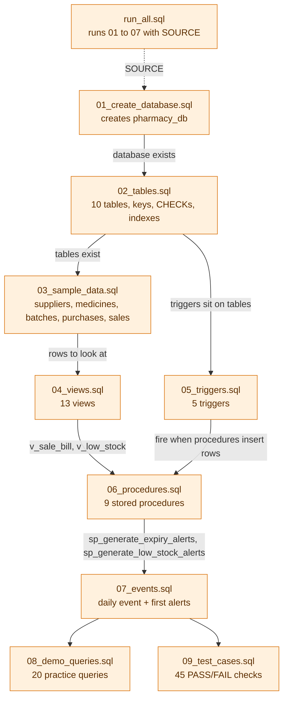
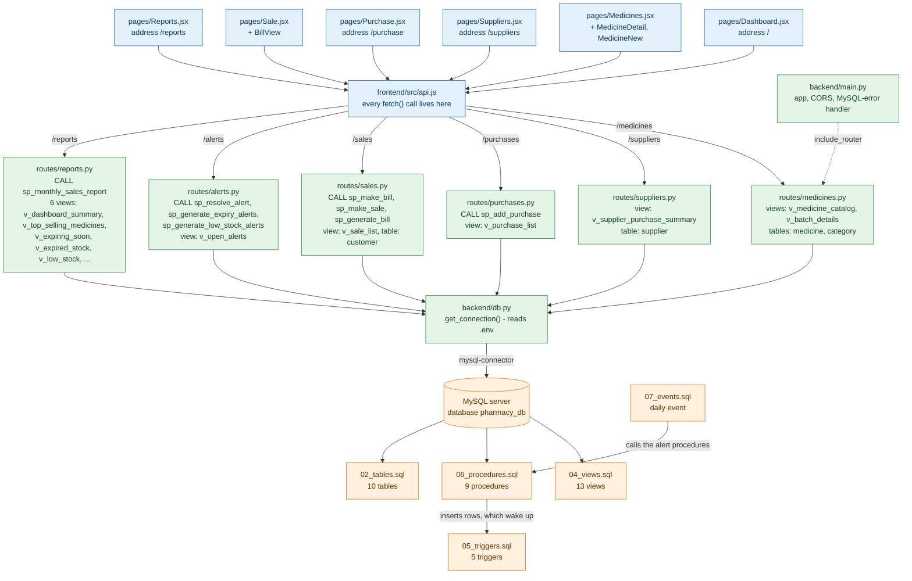

<!--
=====================================================================
FILE        : docs/file_connections.md
WHAT IT DOES: FLOWCHART 1 - shows how EVERY file of the project connects to the others:
              which SQL file depends on which (Part A), and which web page uses which
              JavaScript file, which backend route and which procedure or view (Part B).
              It is drawn as two charts because one chart with every arrow would be too wide to read.
DEPENDS ON  : all the other files (it only describes them).
USED BY     : you - to find "where does this click end up?" and "what must run before what?".
READ ORDER  : see docs/reading_order.md (this is the map, that is the walking route).
=====================================================================
-->

# File connections - flowchart 1

**How to read the charts:** an arrow `A --> B` means "A uses B" or "A must exist / run before B". The text on
the arrow says *what* is used. Colours: **blue** = web pages and scripts (`frontend/`), **green** = Python
backend (`backend/`), **orange** = MySQL files (`database/`).

---

## Part A - the database files: what depends on what

Order of creation: **tables -> data -> views -> triggers -> procedures -> events**.



**In words**

1. `01` creates the empty database, `02` creates the tables inside it, `03` fills the tables.
2. `04` (views) only reads tables, so it comes after `02`; `05` (triggers) is attached to tables, so it also needs `02`.
3. `06` (procedures) is built last of the logic: it reads views (`v_sale_bill`, `v_low_stock`) and inserts rows
   that wake up the triggers, so it needs `04` and `05`.
4. `07` (event) just calls two procedures from `06` every day.
5. `run_all.sql` runs `01` to `07` in this order. `08` and `09` are run by hand afterwards.

---

## Part B - the website: from a click to MySQL and back

```
browser page -> React component -> api.js -> FastAPI route -> db.py -> MySQL (procedure / view / table)
```



**In words**

1. **The pages (blue) never talk to MySQL.** Every React page imports `api` from `api.js` and calls
   `api.something()`; `api.js` sends the HTTP request, the backend answers, React stores the answer in state and draws it.
2. **The backend (green) is a thin messenger.** `main.py` plugs in the six route files. Every route asks
   `db.py` for a connection and then runs exactly one thing in MySQL: a `SELECT` on a **view**, a `CALL` of a
   **procedure**, or (for plain add/edit forms) a simple `INSERT`/`UPDATE` on a **table**.
   The labels on the arrows show *which* views and procedures each route uses.
3. **MySQL (orange) does the real work.** A procedure inserts rows; that wakes up the triggers, which change stock
   and may create alerts. The daily event calls the same alert procedures by itself.
4. **What happens inside MySQL when you sell something** (automatic, so not drawn as extra arrows):
   `sp_make_bill` -> `sp_add_medicine_to_sale` inserts `sale_item` rows -> trigger `trg_sale_item_before_insert`
   checks expiry/stock -> trigger `trg_sale_item_after_insert` reduces the batch -> trigger
   `trg_batch_after_update_low_stock` may insert a `stock_alert`.

---

## Table 1 - which web page uses which script and which backend URL

| Address | React page | Backend URLs it calls (through `api.js`) | MySQL object behind each URL |
|------|--------|------------------------------------------|------------------------------|
| `/` | `Dashboard.jsx` | `GET /reports/dashboard` | view `v_dashboard_summary` |
| | | `GET /alerts` | view `v_open_alerts` |
| | | `POST /alerts/{id}/resolve` | procedure `sp_resolve_alert` |
| | | `POST /alerts/refresh` | procedures `sp_generate_expiry_alerts`, `sp_generate_low_stock_alerts` |
| | | `GET /reports/low-stock`, `GET /reports/expiring-soon` | views `v_low_stock`, `v_expiring_soon` |
| `/medicines`, `/medicines/:id`, `/medicines/new` | `Medicines.jsx`, `MedicineDetail.jsx`, `MedicineNew.jsx` | `GET /medicines` (`?search=`) | view `v_medicine_catalog` |
| | | `GET /medicines/categories` | table `category` |
| | | `GET /medicines/{id}/batches` | view `v_batch_details` |
| | | `POST /medicines`, `PUT /medicines/{id}` | table `medicine` (INSERT / UPDATE) |
| `/suppliers` | `Suppliers.jsx` | `GET /suppliers` | view `v_supplier_purchase_summary` + table `supplier` |
| | | `POST /suppliers` | table `supplier` (INSERT) |
| `/purchase` | `Purchase.jsx` | `GET /suppliers`, `GET /medicines` | (as above) |
| | | `POST /purchases` | procedure `sp_add_purchase` (+ triggers 1 and 2) |
| | | `GET /purchases` | view `v_purchase_list` |
| `/sale` | `Sale.jsx` (+ `BillView.jsx`) | `GET /sales/customers`, `POST /sales/customers` | table `customer` |
| | | `GET /medicines` | view `v_medicine_catalog` |
| | | `POST /sales` | procedure `sp_make_bill` -> `sp_add_medicine_to_sale` (+ triggers 3, 4, 5) |
| | | `GET /sales/{id}/bill` | procedure `sp_generate_bill` (reads view `v_sale_bill`) |
| | | `GET /sales` | view `v_sale_list` |
| `/reports?tab=...` | `Reports.jsx` | `GET /reports/monthly-sales` | procedure `sp_monthly_sales_report` |
| | | `GET /reports/top-selling` | view `v_top_selling_medicines` |
| | | `GET /reports/expiring-soon`, `/expired`, `/low-stock` | views `v_expiring_soon`, `v_expired_stock`, `v_low_stock` |
| | | `GET /reports/supplier-summary` | view `v_supplier_purchase_summary` |

*(The URL `POST /sales/single` -> `sp_make_sale` exists too, for selling one medicine on a new bill; the pages use the cart version.)*

## Table 2 - the nine procedures and what they call

| Procedure | Calls | Triggers fired by its inserts |
|-----------|-------|-------------------------------|
| `sp_add_purchase` | - | `trg_purchase_item_before_insert`, `trg_purchase_item_after_insert` (stock goes up, so `trg_batch_after_update_low_stock` does nothing) |
| `sp_add_medicine_to_sale` | - | `trg_sale_item_before_insert`, `trg_sale_item_after_insert` -> `trg_batch_after_update_low_stock` |
| `sp_make_sale` | `sp_add_medicine_to_sale` | (same as above) |
| `sp_make_bill` | `sp_add_medicine_to_sale` (once per cart item) | (same as above) |
| `sp_generate_bill` | reads view `v_sale_bill` | - |
| `sp_monthly_sales_report` | reads view `v_sale_bill` | - |
| `sp_resolve_alert` | - | - |
| `sp_generate_expiry_alerts` | - | - |
| `sp_generate_low_stock_alerts` | reads view `v_low_stock` | - |

`evt_daily_stock_alerts` (07) calls `sp_generate_expiry_alerts` and `sp_generate_low_stock_alerts` every day at 01:00.

