<!--
=====================================================================
FILE        : docs/reading_order.md
WHAT IT DOES: FLOWCHART 2 - the exact order in which to READ the code so that every file
              makes sense when you reach it (each step only needs what you read before).
              Under the chart, one line per step says what you will learn from that file.
DEPENDS ON  : all the other files (it only points to them).
USED BY     : you - especially when you divide the files among the four team members and
              before the viva.
READ ORDER  : read this right after the README.
=====================================================================
-->

# Reading order - flowchart 2

Read from the top to the bottom. **Do not skip ahead**: for example, the procedures only make sense
after you know the tables, the views and the triggers.
Rough time needed: 4-5 hours to read everything once and run the demos.

```mermaid
flowchart TD
    subgraph A["A. Design"]
        N1["Step 1: README.md"]
        N2["Step 2: docs/er_diagram.md"]
        N3["Step 3: docs/normalization.md"]
        N1 --> N2 --> N3
    end

    subgraph B["B. Database"]
        N4["Step 4: 01_create_database.sql"]
        N5["Step 5: 02_tables.sql"]
        N6["Step 6: 03_sample_data.sql"]
        N7["Step 7: 04_views.sql"]
        N8["Step 8: 05_triggers.sql"]
        N9["Step 9: 06_procedures.sql"]
        N10["Step 10: 07_events.sql"]
        N11["Step 11: run_all.sql"]
        N12["Step 12: 08_demo_queries.sql"]
        N13["Step 13: 09_test_cases.sql"]
        N4 --> N5 --> N6 --> N7 --> N8 --> N9 --> N10 --> N11 --> N12 --> N13
    end

    subgraph C["C. Backend"]
        N14["Step 14: requirements.txt and .env.example"]
        N15["Step 15: backend/db.py"]
        N16["Step 16: backend/main.py"]
        N17["Step 17: routes/medicines.py"]
        N18["Step 18: routes/suppliers.py"]
        N19["Step 19: routes/purchases.py"]
        N20["Step 20: routes/sales.py"]
        N21["Step 21: routes/alerts.py"]
        N22["Step 22: routes/reports.py"]
        N14 --> N15 --> N16 --> N17 --> N18 --> N19 --> N20 --> N21 --> N22
    end

    subgraph D["D. Frontend"]
        N23["Step 23: src/api.js + useLoad.js"]
        N24["Step 24: main.jsx, App.jsx, Layout"]
        N25["Step 25: Dashboard + Medicines pages"]
        N26["Step 26: Purchase + Suppliers pages"]
        N27["Step 27: Sale page + BillView"]
        N28["Step 28: Reports page"]
        N29["Step 29: src/styles.css"]
        N23 --> N24 --> N25 --> N26 --> N27 --> N28 --> N29
    end

    subgraph E["E. Wrap up"]
        N30["Step 30: docs/file_connections.md"]
        N31["Step 31: docs/work_split.md"]
        N32["Step 32: docs/viva_questions.md"]
        N30 --> N31 --> N32
    end

    N3 --> N4
    N13 --> N14
    N22 --> N23
    N29 --> N30

    classDef a fill:#eef2ff,stroke:#4f46e5,color:#1e1b4b;
    classDef b fill:#fff1de,stroke:#d9730d,color:#5c2e00;
    classDef c fill:#e4f5e8,stroke:#2b8a3e,color:#14451f;
    classDef d fill:#e3f1fb,stroke:#1f6fb2,color:#0b3a5e;
    classDef e fill:#f3e8ff,stroke:#7e22ce,color:#3b0764;
    class N1,N2,N3 a;
    class N4,N5,N6,N7,N8,N9,N10,N11,N12,N13 b;
    class N14,N15,N16,N17,N18,N19,N20,N21,N22 c;
    class N23,N24,N25,N26,N27,N28,N29 d;
    class N30,N31,N32 e;
```

## What you will learn from each step

### A. Understand the problem and the design
1. **`README.md`** - what the system does, the tech stack and how to run it, so you know the goal before reading any code.
2. **`docs/er_diagram.md`** - the 10 tables, their keys and relationships, and why stock is tracked per batch.
3. **`docs/normalization.md`** - why the data is split into so many tables: UNF to 1NF, 2NF, 3NF, and the proof that the design is in 3NF.

### B. The database
4. **`database/01_create_database.sql`** - how a database is created (`CREATE DATABASE`, character set, `USE`).
5. **`database/02_tables.sql`** - primary keys, foreign keys with `ON DELETE`/`ON UPDATE`, `CHECK`, `UNIQUE`, `DEFAULT` and why each index exists.
6. **`database/03_sample_data.sql`** - how realistic data is inserted in the right order, dates relative to `CURDATE()`, and why opening stock is calculated with one `UPDATE`.
7. **`database/04_views.sql`** - views as saved queries: joins, `GROUP BY`, `CASE`, and the "sellable vs expired" definition used everywhere.
8. **`database/05_triggers.sql`** - BEFORE vs AFTER triggers, `NEW`/`OLD`, `SIGNAL`, and how stock changes automatically.
9. **`database/06_procedures.sql`** - transactions (`COMMIT`/`ROLLBACK`), exit handlers, cursors and loops, JSON input, and the FEFO selling algorithm.
10. **`database/07_events.sql`** - scheduled events, the event scheduler, and why time-based alerts need an event and not a trigger.
11. **`database/run_all.sql`** - the exact order in which the database is built and how to reset it.
12. **`database/08_demo_queries.sql`** - 20 queries from `SELECT` to window functions; use it to practise for the viva.
13. **`database/09_test_cases.sql`** - how each trigger, procedure, view and event is tested, including the failure cases and the stock reconciliation.

### C. The backend
14. **`backend/requirements.txt`, `.env.example`** - which packages are needed and how the database password is kept out of the code.
15. **`backend/db.py`** - the single function that opens a MySQL connection.
16. **`backend/main.py`** - how the app starts, what CORS is, and how MySQL error messages (`SIGNAL`) become clear HTTP answers.
17. **`backend/routes/medicines.py`** - how a route calls a view, parameterized queries and why they stop SQL injection.
18. **`backend/routes/suppliers.py`** - the simplest list + add pair; reinforces the pattern.
19. **`backend/routes/purchases.py`** - calling a stored procedure with `callproc`, an `OUT` parameter and a JSON argument.
20. **`backend/routes/sales.py`** - selling through `sp_make_bill` and reading a procedure that returns two result sets (the bill).
21. **`backend/routes/alerts.py`** - resolving alerts and refreshing them from the app.
22. **`backend/routes/reports.py`** - reports as views, and a procedure that returns three result sets.

### D. The frontend
23. **`frontend/src/api.js`, `useLoad.js`, `utils.js`** - the one place where every `fetch()` lives, how errors become readable messages, and the hook that loads data into React state.
24. **`frontend/index.html`, `src/main.jsx`, `App.jsx`, `components/Layout.jsx`** - how React starts, how addresses map to pages (react-router), and the sidebar frame around every page.
25. **`pages/Dashboard.jsx`, `Medicines.jsx`, `MedicineDetail.jsx`, `MedicineNew.jsx`** - state and effects, tables built from data, search with a delay (debouncing), forms with controlled inputs.
26. **`pages/Purchase.jsx`, `Suppliers.jsx`** - a form with a variable number of rows kept in state and sent as one request.
27. **`pages/Sale.jsx`, `components/BillView.jsx`** - the shopping cart, the printable bill, and why the page never chooses batches or prices.
28. **`pages/Reports.jsx`** - tabs kept in the address (`?tab=low`) and loading each report on demand.
29. **`frontend/src/styles.css`** - optional: design tokens (colours, spacing), sidebar layout and the print style for the bill.

### E. Wrap up
30. **`docs/file_connections.md`** - the big picture of how all files connect (flowchart 1).
31. **`docs/work_split.md`** - who explains what in the viva.
32. **`docs/viva_questions.md`** - 15 likely questions with short answers; read it last, then try to answer without looking.

